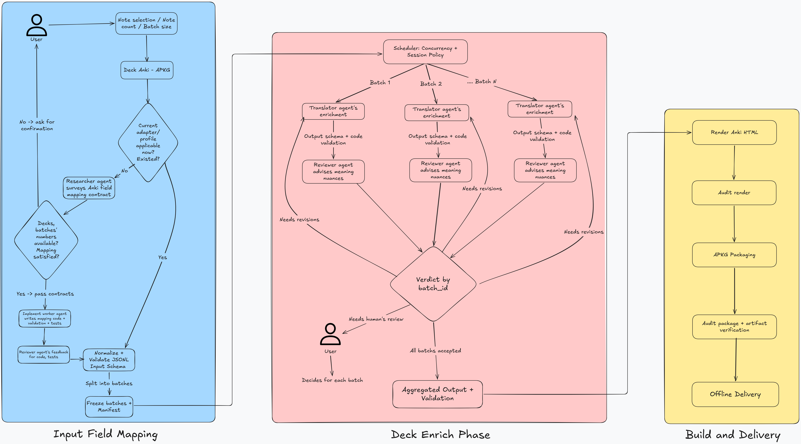
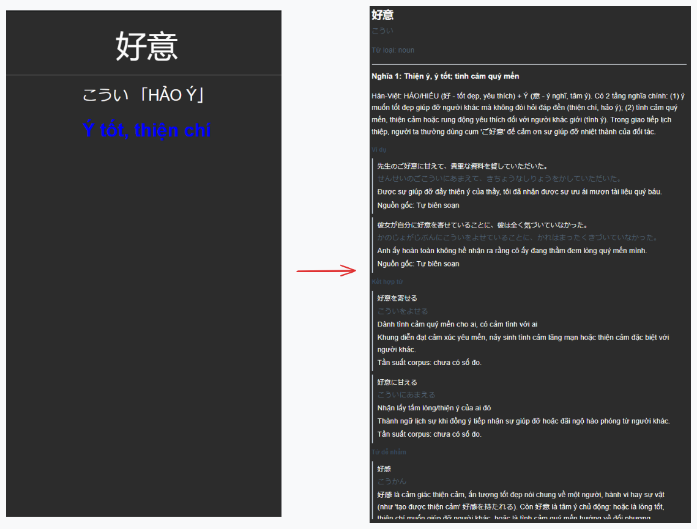

# Anki Deck Enrich

🇬🇧 [English](../README.md) | 🇻🇳 **Tiếng Việt**

Làm giàu deck Anki từ vựng tiếng Nhật bằng giải thích tiếng Việt và bằng chứng từ điển có thể truy vết.

## Vấn đề

Phần lớn deck từ vựng tiếng Nhật được chia sẻ chỉ dừng ở từ và nghĩa ngắn. Như vậy đủ để nhận ra từ, nhưng chưa đủ để dùng nó:

- **Chỉ có từ và nghĩa.** Mỗi thẻ một nghĩa ngắn, không giải thích sắc thái hay ngữ vực.
- **Thiếu collocation.** Học một danh từ nhưng không biết động từ, trợ từ nào thường đi kèm.
- **Thiếu ví dụ.** Không có câu trong ngữ cảnh thì khó biết khi nào từ thực sự phù hợp.
- **Thiếu từ đồng nghĩa và từ liên quan.** Các từ gần nghĩa được học rời rạc, không ai nói rõ giới hạn thay thế cho nhau.
- **Thiếu từ trái nghĩa.** Không có cặp nghĩa đối lập để neo từ vào trí nhớ.
- **Thiếu các từ dễ nhầm lẫn.** Các từ giống mặt chữ hoặc giống âm không được đối chiếu, nên cứ bị nhầm mãi.

Làm giàu thẻ thủ công thì chậm, còn chỉ dùng LLM thì cho ra văn bản rất tự tin nhưng không có cách nào kiểm tra nguồn gốc.

## Giải pháp

Anki Deck Enrich là một **pipeline multi-agent**: agent làm phần ngôn ngữ và nghiên cứu, còn code tất định kiểm tra và build mọi thứ xung quanh.

| Agent | Trách nhiệm |
| --- | --- |
| Orchestrator | Chia việc thành các batch, giao việc cho từng agent bằng work packet, theo dõi trạng thái và chỉ chốt một batch khi validation và review đều đạt |
| Researcher | Khảo sát các field của deck mới và viết mapping contract cho adapter |
| Implementer | Viết code adapter và test từ contract đó |
| Translator | Làm giàu một batch: nghĩa và giải thích tiếng Việt, collocation, ví dụ, từ liên quan và từ dễ nhầm |
| Reviewer | Kiểm tra độc lập đúng một artifact (code hoặc một batch đã dịch) và trả về `pass`, `needs_revision` hoặc `needs_human_review` |

Các agent không bàn giao qua lịch sử chat. Mỗi agent đọc một work packet và ghi kết quả ra file (bản ghi JSONL, báo cáo JSON kèm hash), nhờ vậy một session mới có thể làm tiếp từ trạng thái đã lưu. Batch cần sửa sẽ quay về translator của nó; batch cần người quyết sẽ được chuyển cho user. Các batch chạy độc lập với nhau.

Xung quanh các agent, code đảm nhận phần tất định:

- **Source adapter.** Đọc file `.apkg` gốc, ánh xạ field sang input schema chặt chẽ và đóng băng các note đã chọn thành các batch kèm manifest.
- **Bằng chứng truy vết được.** Các nhận định đều kèm tham chiếu bằng chứng tới [JMdict](https://www.edrdg.org/wiki/Main_Page.html), [Tatoeba](https://tatoeba.org/en/), [Weblio](https://www.weblio.jp/) hoặc [Tsukuba Web Corpus](https://tsukubawebcorpus.jp/en/). Điều gì chưa kiểm chứng được sẽ ghi thành uncertainty thay vì trình bày như sự thật.
- **Validation.** JSON Schema cùng các kiểm tra bằng code cho ID, thứ tự, revision, hash và liên kết nguồn ở mọi stage. Một batch chỉ được chấp nhận khi đúng artifact đã review được gắn với bản review của nó.
- **Aggregate và build.** Các batch đã chấp nhận được gộp theo thứ tự manifest, render thành HTML cho Anki và đóng gói bằng [genanki](https://github.com/kerrickstaley/genanki) thành file `.apkg` offline đã qua audit.

Xây dựng bằng Python 3.13, `jsonschema`, PyYAML và `genanki`. Mỗi stage là một lệnh CLI chạy theo một file YAML config tường minh.

## Cấu trúc project



> [!NOTE]
> Ba giai đoạn: **Input Field Mapping** (adapter, chuẩn hoá, đóng băng batch), **Deck Enrich Phase** (translator và reviewer theo từng batch, rồi aggregate) và **Build and Delivery** (render, audit, đóng gói). Khối scheduler thể hiện chính sách chạy song song dự kiến; hiện tại các batch được điều phối bên ngoài CLI này.

### Trước và sau khi làm giàu



> [!NOTE]
> Bên trái: thẻ gốc (từ, cách đọc, nghĩa). Bên phải: cùng note đó sau khi làm giàu, có giải thích tiếng Việt, collocation, ví dụ, từ liên quan và từ dễ nhầm, mỗi mục đều gắn với nguồn. Ví dụ dùng dữ liệu tự tạo, không lấy từ deck gốc.

## Bắt đầu nhanh

Cần Python 3.13 trở lên. Cài dependency bằng `uv sync` (rồi thêm `uv run` trước các lệnh bên dưới), hoặc `pip install genanki==0.13.1 "jsonschema>=4.18,<5" PyYAML==6.0.3`.

### Chạy thử demo synthetic

Demo build một deck 5 note từ các bản ghi tự tạo đã được làm giàu sẵn, nên không cần deck Anki nào:

```sh
python -m jp_deck validate-output --config configs/synthetic-demo.yaml
python -m jp_deck build --config configs/synthetic-demo.yaml --output-dir /tmp/jp-deck-demo
```

Sau đó `/tmp/jp-deck-demo/` sẽ có `synthetic-vocabulary.apkg`, `preview.html` (mở bằng trình duyệt) và `audit.json`. Chạy bộ test bằng `python -m unittest discover -s tests`.

### Chạy với deck thật

1. **Đặt deck** vào `datasets/`, ví dụ `datasets/my-deck.apkg`. `datasets/`, `jobs/`, `artifacts/` và `configs/*.yaml` (trừ file demo) đều đã được gitignore, nên dữ liệu thật và output của các lần chạy chỉ nằm ở local.
2. **Viết config** tại `configs/my-deck.yaml`, dựa trên `configs/synthetic-demo.yaml`. Thêm khối `source` (đường dẫn và SHA-256 của APKG, adapter ID, mapping contract, ID của deck và note type, thứ tự và số lượng note được chọn), các đường dẫn output của `normalization` và mục `batching` với `batch_size` và `output_dir`. Đường dẫn tính tương đối từ file YAML. Với deck mới, agent implementer có thể viết config này cùng lúc với adapter, trực tiếp từ mapping contract của researcher.
3. **Chạy các stage** theo thứ tự:

   ```sh
   python -m jp_deck normalize        --config configs/my-deck.yaml   # APKG -> JSONL đã chuẩn hoá + source map
   python -m jp_deck validate-input   --config configs/my-deck.yaml
   python -m jp_deck prepare-batches  --config configs/my-deck.yaml   # batch đã đóng băng + manifest
   # agent làm giàu và review từng batch; orchestrator ghi acceptance
   python -m jp_deck validate-batches   --config configs/my-deck.yaml
   python -m jp_deck aggregate-output   --config configs/my-deck.yaml
   python -m jp_deck validate-aggregate --config configs/my-deck.yaml
   python -m jp_deck build              --config configs/my-deck.yaml   # APKG + preview + audit
   ```

> [!IMPORTANT]
> Hiện chỉ có một source adapter được đăng ký (`tango-n1-mimi-n1-v1`), và nó chỉ chấp nhận đúng một snapshot deck đã được ghim bằng hash. Deck khác cần agent researcher và implementer thêm adapter trước. Bản thân bước làm giàu chạy qua các agent, không qua CLI. Validation và đóng gói chỉ kiểm tra cấu trúc và nguồn gốc, không kiểm tra chất lượng ngôn ngữ: build thành công không có nghĩa là lời giải thích tiếng Việt đã đúng. Việc import, reimport và lịch ôn trong Anki thật chưa được kiểm chứng, và repository này không chứa deck thật hay dữ liệu đã dịch nào.

## Trạng thái hiện tại

- **Mới thử nghiệm ở quy mô pilot.** Toàn bộ luồng, từ deck gốc qua làm giàu bằng agent, review, aggregate đến file APKG đã audit, mới chạy trên một pilot 45 note chia thành 2 batch (25 + 20). Chưa thử chạy với nhiều batch hay cả deck.
- **Chưa có orchestration tự động.** Các agent đang được giao việc thủ công theo từng batch và mỗi stage CLI được chạy tay. Scheduler trong sơ đồ pipeline (chạy song song và chính sách session) mới là đề xuất, chưa có script triển khai.
- **Chưa có từ trái nghĩa.** Output schema hỗ trợ từ đồng nghĩa, gần nghĩa, từ liên quan và từ dễ nhầm, nhưng chưa có quan hệ trái nghĩa.
